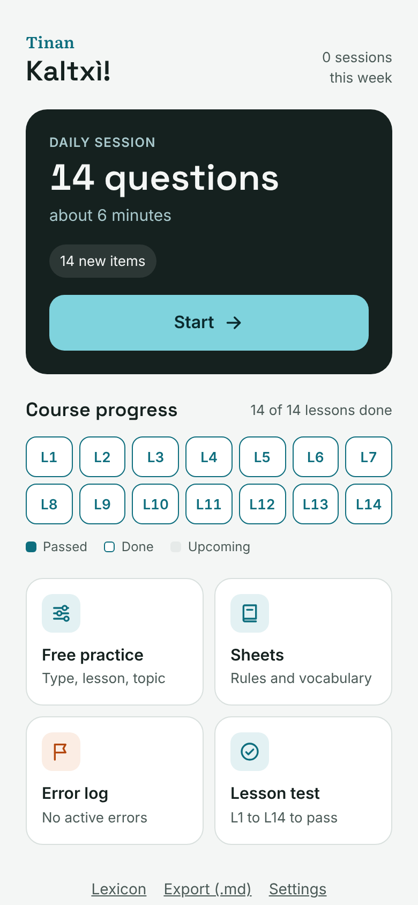
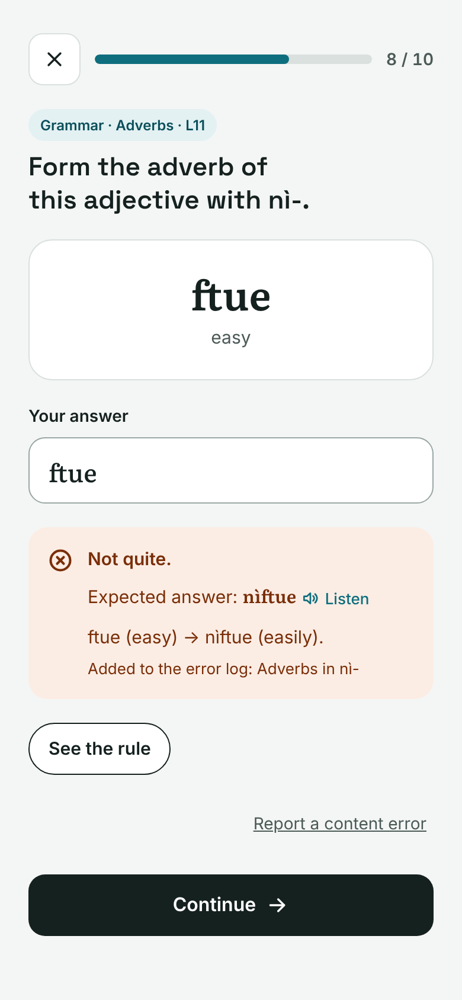
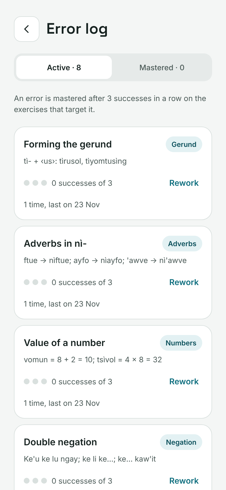
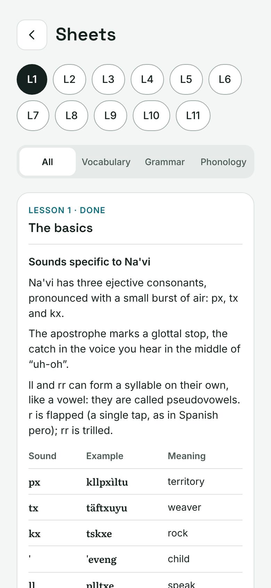

# Tinan leNa'vi

Une app web pour s'entraîner au **Na'vi**, la langue créée par Paul Frommer pour les films *Avatar*. Elle est pensée pour le téléphone, en français et en anglais.

**[▶ Ouvrir l'app](https://merry-goblin.github.io/tinan-lenavi/)** · gratuite · sans compte · [English version](README.md)

  
  
  
  

Captures de l'interface en anglais.

Elle suit un parcours de 14 leçons, des sons de la langue jusqu'à la conversation. Les leçons les plus longues sont découpées en parties de 13 mots au plus.

- **Apprendre** : avant de s'entraîner, une leçon ou une partie se découvre par paquets de quatre mots (découvrir, reconnaître, retrouver, écrire), puis chaque règle avec ses exemples et un exercice. Les mots rejoignent ensuite les révisions ;
- **Séance du jour** : cartes de vocabulaire, QCM, saisie et étiquettes à placer, avec révision espacée ;
- **Entraînement libre** par leçon ou partie de leçon, type d'exercice ou notion ;
- **Carnet d'erreurs** : chaque erreur est classée et revient jusqu'à être maîtrisée ;
- **Bilans** de leçon ou de partie, **fiches** de grammaire et de vocabulaire, **lexique** ;
- **Export** des fiches et de la progression en Markdown.

Après une erreur, « Voir la règle » affiche la règle concernée, avec sa source. Un lien « Écouter » ouvre la page du mot dans le dictionnaire [Reykunyu](https://reykunyu.lu/), qui a des enregistrements pour une partie des mots, avec les voix de Plumps et de tsyili.

Quelle part du Na'vi officiel Tinan couvre-t-il ? Environ 7,6 % du vocabulaire et la moitié de la grammaire : voir [COUVERTURE.md](COUVERTURE.md).

## Pour aller plus loin

Tinan sert à s'entraîner : les fiches expliquent chaque règle, mais ne forment pas un cours complet. Pour des leçons complètes et des gens avec qui parler, voir [Kelutral](https://kelutral.org/), dont le Discord propose des leçons de Na'vi chaque semaine, et [LearnNavi](https://learnnavi.org/), avec son forum et ses ressources.

## Remerciements

Merci à Talisì, de la communauté Kelutral, pour sa relecture détaillée des quatorze leçons. Beaucoup de corrections de l'app viennent de ses retours.

## Signaler une erreur

Le bouton « Signaler » d'un exercice ou d'une fiche ouvre un [ticket](https://github.com/merry-goblin/tinan-lenavi/issues) prérempli sur ce dépôt. Il faut un compte GitHub, et le ticket est public.

## Ta progression

Rien n'est envoyé nulle part, et la page ne charge rien depuis un autre site : les polices sont livrées avec elle. La progression est enregistrée dans le navigateur, sur l'appareil utilisé. Elle n'est donc pas partagée entre deux appareils, et elle disparaît si tu effaces les données du site. On peut aussi l'effacer depuis les Réglages.

## Sources

Chaque règle de l'app donne ses sources, chacune avec un lien. Les références principales sont :

- [Horen Lì'fyayä leNa'vi](https://files.learnnavi.org/docs/horen-lenavi.pdf), la grammaire de référence de LearnNavi ;
- le [Concise Na'vi Dictionary](https://files.learnnavi.org/dicts/NaviPlainDictionary.pdf) de LearnNavi ;
- [Na'viteri](https://naviteri.org/), le blog de Paul Frommer.

En appui : [Kelutral](https://kelutral.org/), *[Na'vi in a Nutshell](https://files.learnnavi.org/docs/Navi_in_a_Nutshell.pdf)*, Wikipédia et Wikibooks. Les formes dérivées ont été contrôlées avec le conjugateur de [Reykunyu](https://reykunyu.lu/).

Le contenu a été préparé avec l'aide de Claude, qui n'a jamais servi de source.

Projet personnel et non commercial, sans lien avec Disney, 20th Century Studios, Lightstorm Entertainment, Paul Frommer, LearnNavi ou Kelutral, ni approuvé par eux. *Avatar* et les noms associés appartiennent à leurs ayants droit.

## Licences

Ce dépôt réunit deux sortes de travail, chacune sous sa licence.

| Quoi | Licence | Fichier |
| --- | --- | --- |
| **Le code** : la structure HTML, les styles CSS et le JavaScript de `index.html` | MIT | [`LICENSE`](LICENSE) |
| **Le contenu pédagogique** : les leçons, les règles et leurs explications, les tableaux et les exemples, les sens des mots, les exercices, leurs pièges et leurs messages, les motifs d'erreur. Dans `index.html`, il forme le bloc de données `window.__CONTENU` | CC BY-SA 4.0 | [`LICENSE-CONTENT`](LICENSE-CONTENT) |

Pour réutiliser le contenu, il faut :
- citer *Tinan leNa'vi*, par merry-goblin, avec le lien https://github.com/merry-goblin/tinan-lenavi ;
- indiquer ce qui a été modifié ;
- partager le résultat sous la même licence, CC BY-SA 4.0.

Le code peut être réutilisé librement, en gardant la mention de licence MIT.

Ce que ces licences ne couvrent pas :
- **la langue na'vi elle-même** : les licences portent sur la façon dont Tinan l'explique et la fait pratiquer, pas sur ses mots ni sur sa grammaire ;
- **les sources citées**, qui gardent leurs propres conditions. Le Horen (William S. Annis, éditeur) est sous CC BY-SA 4.0 : c'est l'une des raisons du choix de cette licence pour le contenu ;
- **les polices** Inter, Space Grotesk et Literata, dans le dossier `fonts`, sous SIL Open Font License 1.1 (licences jointes : `fonts/OFL-*.txt`).

## Pour la maintenance

`index.html` est généré, il ne se modifie pas à la main. C'est l'app Tinan, précédée de son contenu (le bloc `window.__CONTENU`), avec les balises de partage ajoutées à la génération. L'image d'aperçu des liens (`og-image.png`) et les captures de `docs/screenshots` se refont avec un script à part. Le même code tourne dans Claude, où il utilise la base de l'artefact, et seul, où il utilise le contenu intégré et garde la progression dans le `localStorage` du navigateur, sous des clés `tinan/<chemin>`.
