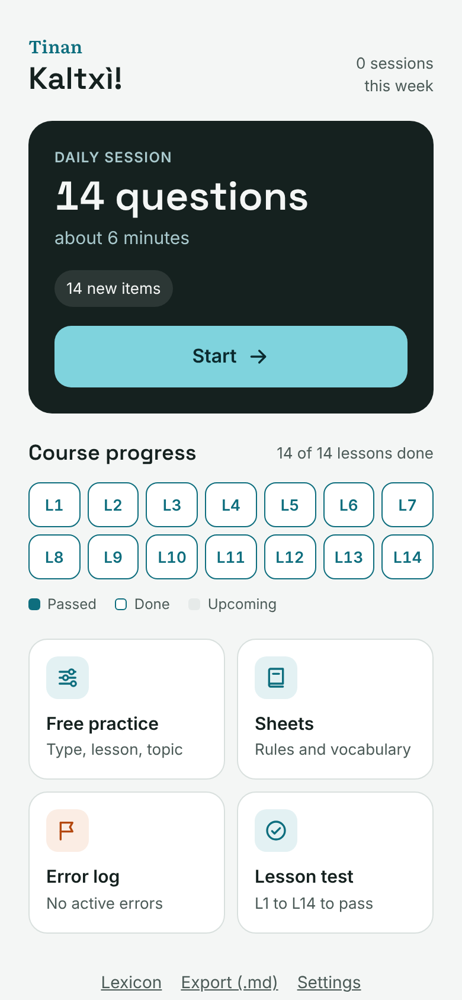
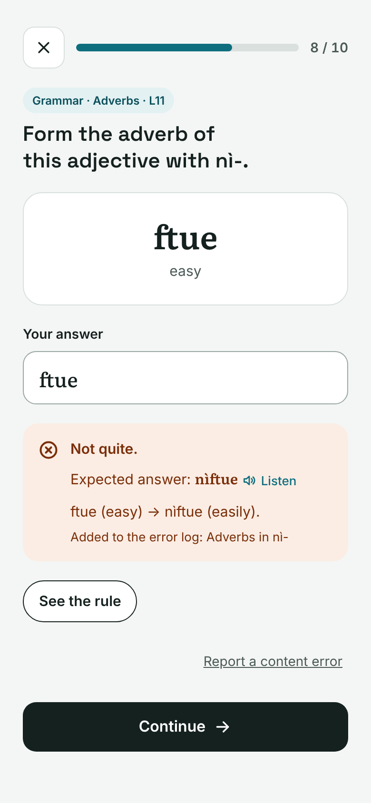
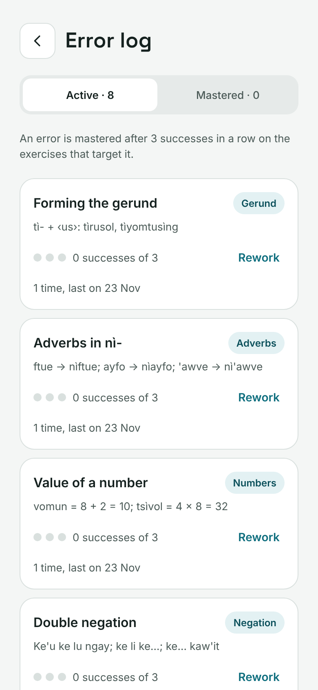
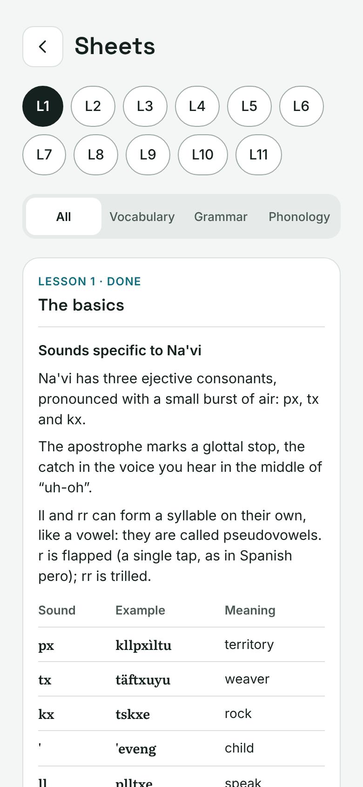

# Tinan leNa'vi

**Learn Na'vi, the language Paul Frommer created for the *Avatar* films, one short session at a time.**

**[▶ Open the app](https://merry-goblin.github.io/tinan-lenavi/)** · free · no account · works on your phone · English and French · [Version française](README.fr.md)

  
  
  
  

## What it does

Tinan follows a 14-lesson course, from the sounds of the language to holding a conversation. The longer lessons are split into short parts of 13 words at most. It has 59 grammar rules, 247 words and 608 exercises.

- **Learn.** Before practising, go through a lesson or a part in sets of four words: discover each word, recognise it, pick it out, then type it. Then each rule, with its examples and one exercise. The words then join your daily reviews.
- **Daily session.** Flashcards, multiple choice, typed answers, forms to build and labels to place, with spaced review so words come back just before you forget them.
- **It tracks your mistakes.** A wrong answer is never just "wrong". Tinan tells you what was expected and why, then files the mistake under one of 69 error patterns: lenition forgotten, infix in the wrong place, missing case ending… The pattern stays in your **error log** until you get it right three times in a row.
- **Free practice.** Pick lessons or parts of lessons, an exercise type or a grammar topic (cases, infixes, lenition, numbers in base 8…).
- **Sheets and lexicon.** Every rule and word you have studied, with tables and examples.
- **Lesson tests** to mark a lesson, or each of its parts, as passed, and **export** of your sheets and progress as Markdown.
- **Listen.** A link opens the word in the [Reykunyu](https://reykunyu.lu/) dictionary, which has recordings for many words, voiced by Plumps and tsyili.

## The course

| | Lesson | | Lesson |
| --- | --- | --- | --- |
| 1 | The basics | 8 | Lenition |
| 2 | Verbs and infixes | 9 | The subjunctive and subordinate clauses |
| 3 | Pronouns | 10 | Numbers in base 8 |
| 4 | Transitive and intransitive | 11 | Adverbs and negation |
| 5 | Adjectives | 12 | Participles |
| 6 | Adpositions | 13 | Formal and colloquial registers |
| 7 | Questions | 14 | Conversation |

The whole course, interface and lessons, is available in English and French.

How much of Na'vi does that cover? About 7.6% of the official vocabulary and half of the grammar in the reference grammar. That is enough to build real sentences, but it is a starting point. See [COUVERTURE.md](COUVERTURE.md) (in French) for the details.

## Going further

Tinan is for practice: the sheets explain each rule, but they are not a full course. For complete lessons and people to talk with, see [Kelutral](https://kelutral.org/), whose Discord runs Na'vi lessons every week, and [LearnNavi](https://learnnavi.org/), with its forum and resources.

## Every rule is sourced

Na'vi has a careful community and an official source, so Tinan does not make anything up. Each rule lists its sources, each with a link. The main references are:

- [Horen Lì'fyayä leNa'vi](https://files.learnnavi.org/docs/horen-lenavi.pdf), the reference grammar;
- the [Concise Na'vi Dictionary](https://files.learnnavi.org/dicts/NaviPlainDictionary.pdf) from LearnNavi;
- [Na'viteri](https://naviteri.org/), Paul Frommer's blog.

Also used: [Kelutral](https://kelutral.org/), *[Na'vi in a Nutshell](https://files.learnnavi.org/docs/Navi_in_a_Nutshell.pdf)*, Wikipedia and Wikibooks. Derived forms were checked with the [Reykunyu](https://reykunyu.lu/) conjugator.

The content was prepared with the help of Claude (Anthropic's AI), which was never used as a source.

## Thanks

Thanks to Talisì, from the Kelutral community, for a detailed review of all fourteen lessons. Many of the corrections in the app come from that review.

## Found a mistake?

Please tell me. The **Report** button on any exercise or sheet opens a pre-filled [issue](https://github.com/merry-goblin/tinan-lenavi/issues) on this repository (you need a GitHub account, and the issue is public). Corrections from experienced speakers are very welcome.

## Your progress stays with you

Nothing is sent anywhere, and the page loads nothing from other sites: the fonts ship with it. Your progress is saved in your browser, on the device you use. It is not shared between devices, and it disappears if you clear the site's data. You can also erase it from Settings.

## Licences

This repository holds two kinds of work, each under its own licence.

| What | Licence | File |
| --- | --- | --- |
| **The code**: the HTML structure, CSS styles and JavaScript in `index.html` | MIT | [`LICENSE`](LICENSE) |
| **The learning content**: lessons, rules and their explanations, tables and examples, word meanings, exercises, their distractors and messages, error patterns. In `index.html`, it is the `window.__CONTENU` data block | CC BY-SA 4.0 | [`LICENSE-CONTENT`](LICENSE-CONTENT) |

To reuse the content:
- credit *Tinan leNa'vi*, by merry-goblin, linking to https://github.com/merry-goblin/tinan-lenavi;
- say what you changed;
- share the result under the same licence, CC BY-SA 4.0.

The code can be reused freely, keeping the MIT licence notice.

These licences do not cover:
- **the Na'vi language itself**: they cover how Tinan explains and practises it, not its words or its grammar;
- **the sources cited**, which keep their own terms. The Horen (William S. Annis, editor) is under CC BY-SA 4.0, which is one reason that licence was chosen for the content;
- **the fonts** Inter, Space Grotesk and Literata, in the `fonts` folder, under the SIL Open Font License 1.1 (`fonts/OFL-*.txt`).

## Not official

Tinan is a personal, non-commercial fan project. It is not affiliated with or endorsed by Disney, 20th Century Studios, Lightstorm Entertainment, Paul Frommer, LearnNavi or Kelutral. *Avatar* and related names belong to their owners.

## For maintenance

`index.html` is generated and is not edited by hand. It is the Tinan app preceded by its content (the `window.__CONTENU` block), with the sharing tags added at build time. The link preview image (`og-image.png`) and the screenshots in `docs/screenshots` are regenerated by a separate script. The same code also runs inside Claude, where it uses the artifact's database. On its own, it uses the embedded content and keeps progress in the browser's `localStorage`, under `tinan/<path>` keys.

## Links

- 

